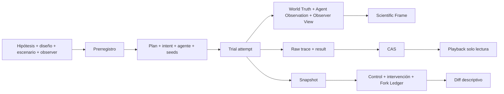

# Hipergrafo operacional

[[knowledge/00 Control/Inicio|← Inicio]] · [[knowledge/02 Arquitectura/Mapa del sistema|Mapa del sistema]]

Este mapa conecta los elementos que no son una afirmación teórica: experimento,
observer, intento, frame, CAS, playback y fork. Es una relación operacional
tipada, no evidencia ni un mecanismo científico demostrado.

Consulta [el contrato](../../docs/OPERATIONAL_HYPERGRAPH_CONTRACT.md) para
roles, cardinalidades y firewalls.
