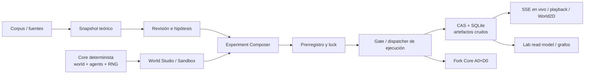

# Informe verificable del sistema — 2026-09-14

[[knowledge/00 Control/Inicio|← Inicio]] · [[knowledge/_generated/Estado tecnico|Estado técnico]] · [[knowledge/02 Arquitectura/Mapa del sistema|Mapa del sistema]] · [[knowledge/01 Roadmap/Ruta activa|Ruta activa]]

> [!important] Alcance y fuente
> Este informe describe el repositorio versionado en `f105eb2` (`experiment/cognitive-live-observatory-01`) y compara Fork Core desde `ed15b7c`. Es una síntesis técnica y no promueve resultados a evidencia científica. `project_manifest.json`, los artefactos CAS y los snapshots siguen siendo las fuentes técnicas normativas. Al inspeccionarlo existía una modificación local ajena en `terrario/lab/worldstream/contracts.py`; queda expresamente fuera de este informe y no se atribuye a Fork Core.

## Resumen ejecutivo

Terrario es infraestructura de investigación para ejecutar mundos deterministas con agentes, registrar transiciones, conservar artefactos crudos con procedencia y ofrecer inspección científica de solo lectura. No afirma que un agente sea inteligente ni que un resultado sea evidencia confirmatoria por el mero hecho de ejecutarse.

El sistema contiene un núcleo de simulación funcional, cinco arquitecturas de agente, mundos D0–D4 con distintos grados de madurez, un Lab local con persistencia SQLite/CAS, preregistro, gate de ejecución científica, trazas y reproducción visual. La observación científica en vivo ya está implementada para intentos de ejecución: publica frames atómicos por SSE, conserva una ventana acotada y pasa a playback desde CAS al terminar. Fork Core también está implementado, pero su calificación exacta es deliberadamente estrecha: solo `A0_RANDOM × d0_differences`.

El trabajo pendiente no es un vacío genérico: incluye QA de navegador para preregistro, endurecimiento del registro y kernel de interacción, device runtime/GPU, orquestación productiva, pipeline de evidencia, API UX, calificación D2–D4 y autorización humana para un piloto. No hay base para tratar esos carriles como completos.

## Cierre técnico — COGNITIVE-LIVE-OBSERVATORY-01

> [!success] Cierre de implementación, no promoción científica
> El 2026-09-14 se cerró la Fase I sobre `experiment/cognitive-live-observatory-01`, desde el baseline `f105eb2` y con HEAD técnico `f210790`. No se hizo push, no se escribió EvidenceGraph y no se alteró Fork Core.

La ruta cerrada es única y científica: `scientific_state()` normaliza estado declarado por el agente; tras `learn()` el controlador captura un frame atómico; `ScientificFrame.cognitive_state` viaja por LIVE/SSE y se sella dentro de `SCIENTIFIC_TRACE` para playback CAS. El frontend no recaptura estado: renderiza el payload del frame y muestra explícitamente `UNSUPPORTED`, `UNAVAILABLE`, `NON-FINITE` y `MALFORMED`.

- La proyección de transporte es determinista y acotada: preview 16, mappings 16 entradas, strings 160 caracteres, claves 80, forma 8 dimensiones y máximo serializado 16 KiB. La evidencia cruda permanece en observer/forensic/CAS; la proyección no la sustituye.
- Un fallo de `frame_sink`, publicación o serialización queda registrado como `FRAME_SINK_FAILURE`, pero ya no altera decisión, mundo, aprendizaje, RNG ni estado terminal. El dispatcher falla cerrado después de la trayectoria como `MATERIALIZATION_FAILED` y no sella una traza científica incompleta.
- El último frame vuelve a ser el frame post-aprendizaje atómico con `runtime_state = COMPLETED`; CAS y el estado durable se completan antes de `TERMINAL`.
- WorldStream/sandbox quedó en cuarentena: no existe `cognitive_state` ni renderer cognitivo integrado en `WorldFrame`; sigue siendo `NOT EVIDENCE`.
- Scientific World2D sigue siendo solo lectura. Añade Follow live / Inspect frame, que cambian únicamente el estado del visor; una inspección declara que el runtime sigue activo. Deltas sólo se calculan entre frames adyacentes de la misma identidad científica.

### Matriz de capacidad observada

| Arquitectura | Estado científico que el contrato expone |
| --- | --- |
| A0 | identidad/paso; política, memoria, temporal y predicción `NOT_APPLICABLE`. |
| A1 | identidad/paso/acción seleccionada; no implementa `get_scientific_state`, por lo que no se infiere política, memoria o predicción. |
| A2 | igual que A1: no se fabrican señales desde campos privados. |
| A3 | temporal y predicción declarados; política y memoria de largo plazo no expuestas. |
| A4 | temporal, política, predicción/error, incertidumbre, memoria y resumen de aprendizaje declarados. |

### Evidencia de QA y recursos

- Backend: 55 pruebas pasaron en `tests/test_scientific_state_contract.py`, `test_observer_passivity_campaign.py`, `test_scientific_live_observability.py`, `test_worldstream.py` y `test_causal_fork_core.py` (advertencia CUDA conocida: no disponible).
- Frontend unit: 34/34 pasaron. Cubre compatibilidad histórica sin `cognitive_state`, resync atómico y deltas con frontera de identidad.
- Medición real D2 / dos pasos: A0 1,130 B cognitivos y 4,605 B de frame; A3 2,673 B y 6,156 B; A4 3,751 B y 7,221 B. El mayor vector proyectado fue 256 valores. El caso sintético de 10,000 valores produjo 392 B, count 10,000 y preview 16.
- Chromium y Firefox: `NOT_TESTED`. El runner no tenía `chromium_headless_shell`; se intentó descargar Playwright, pero la descarga no completó en esta sesión. Memoria de navegador: `NOT_TESTED` por la misma causa.

### Gates de cierre

| Gate | Estado | Evidencia |
| --- | --- | --- |
| G01–G02 | PASS | backup externo `/tmp/terrario-cognitive-observatory-wip.H9TIrJ`; ausencia verificada de hunks cognitivos WorldStream. |
| G03–G05 | PASS | normalización pre-transporte, tests NaN/±Inf/malformed y frame post-learning. |
| G06–G09 | PASS | failure injection, `MATERIALIZATION_FAILED`, orden CAS→durable→terminal y frame final `COMPLETED`. |
| G10–G12 | PASS | límite 16 KiB, proyección separada y frame histórico sin cognición válido. |
| G13–G16 | PASS | matriz A0–A4, paridad LIVE/CAS A4, reducer de resync y deltas identity-safe. |
| G17–G23 | PASS | UI read-only, firewalls Evidence/Fork, regresión A0×D0 y artefactos protegidos sin cambios. |
| G24–G25 | PASS | 55 backend y 34 frontend unit. |
| G26–G27 | NOT_TESTED | ejecutables Chromium/Firefox ausentes; descarga de runner incompleta. |
| G28 | PASS | tamaños backend medidos y la limitación de memoria browser registrada como `NOT_TESTED`. |

El backup forense previo al arreglo vive fuera del worktree en `/tmp/terrario-cognitive-observatory-wip.H9TIrJ` (`tracked-wip.patch` SHA-256 `f391c2f9f15245879509e3af32536860ecb606f6d2154448caea01a57ae44cb5`). Los documentos de vault continúan separados de los commits técnicos.

## Estado verificable de Git y Fork Core

| Hecho | Evidencia |
| --- | --- |
| Rama actual | `experiment/cognitive-live-observatory-01` |
| HEAD versionado | `f105eb2` — `Record causal fork protected baseline` |
| Fork Core | `410b269` — `Add exact causal fork core for qualified A0 D0 runtime` |
| Base anterior | `ed15b7c` — contrato/QA/trazabilidad de observación científica |
| Cambio desde `ed15b7c` | 32 archivos, 2,385 inserciones y 2 borrados; incluye Fork Core, baseline protegido y vault operacional. |
| Integridad basal | `SYSTEM_BASELINE_02` fija digest conductual `2461bd…6884`, igual a Baseline 01. |

Fork Core añadió `terrario/lab/causal.py`, migración SQLite 8, contratos de snapshot/intervención/ledger, pruebas específicas y el baseline protegido. Además hizo explícito el estado causal de A0, reglas y scheduler. No reemplaza el simulador: restaura y ejecuta el runtime real.

### Lo que Fork Core garantiza

- El único límite de bifurcación es `POST_STATE(t*) / PRE_DECISION(t*+1)`.
- Un snapshot canónico, sellado en CAS, contiene escenario materializado, mundo, reglas, scheduler, generador/contador de A0, tick, estado terminal e historia causal. Excluye datos de observer, reloj de pared y cursores visuales.
- La restauración verifica hashes de payload y sobre, CAS, esquema, software e identidad de ejecución/intento/plan/prerregistro. Las ramas se restauran aisladamente y se comprueba su historia compartida.
- Hay control explícito `C00`, sham `C01_SHAM` y solo una mutación de prueba `TEST_ENERGY_DELTA`; no hay I01–I12 científicos implementados.
- Snapshots, eventos de fork y bindings de ramas son append-only/immutables en SQLite. No existe una ruta de escritura desde Fork Core a EvidenceGraph.
- Las pruebas cubren restauración exacta, doble restauración, aislamiento frente a aliasing, control/sham y una divergencia activa declarada; corrupción y runtimes no calificados fallan cerrados.

### Límite firme de Fork Core

La clasificación `EXACT_FORKABLE` solo se concede a `A0_RANDOM` en `d0_differences`. A1–A4 y D1–D4 devuelven `NOT_FORKABLE`; no se debe presentar una reejecución con la misma seed como fork causal. Fallos como snapshot incompleto/corrupto, incompatibilidad de software, intervención inválida o restauración no exacta se rechazan explícitamente.

## Arquitectura construida

### 1. Núcleo de mundo y determinismo

`terrario/core`, `terrario/world`, `terrario/experiment` y `terrario/observer` contienen el núcleo. El mundo usa estado tipado, física, reglas, scheduler, oportunidades y escenarios YAML. `RNGManager` separa y serializa streams Python/NumPy/PyTorch y fija modos deterministas de Torch. El controlador materializa escenario, crea agente, ejecuta transición observar → decidir → consecuencias/reglas → aprender y registra traces/checkpoints.

Capacidades presentes:

- CLI para ejecutar, verificar reproducibilidad, ablation y tests (`main.py`).
- Experimentos con configuración YAML, semillas explícitas, comparaciones y métricas.
- Observer científico que persiste transición completa, manifest y checkpoints; el perfil forense puede capturar activaciones, gradientes y deltas de parámetros cuando la arquitectura los ofrece.
- Separación entre proyección del agente y verdad de mundo/observer: aumentar verbosidad del observer no altera la observación del agente.

### 2. Agentes y mundos

Las arquitecturas implementadas son `A0_RANDOM`, `A1_REACTIVE`, `A2_GRU`, `A3_WORLD_MODEL` y `A4_ADVANCED`; el factory, inspector y el estado científico normalizado exponen qué señales están disponibles. La normalización expresa ausencias como `NOT_APPLICABLE`, no como cero: logits/probabilidades, estado latente/temporal, memoria, predicción/error, incertidumbre, pérdida, gradientes, cambio de parámetros y ablaciones.

Los niveles D0 y D1 están marcados legacy implementados; D2 está integrado en Studio; D3 está implementado; D4 está implementado pero su protocolo no está confirmado. D5–D11 son diseño futuro. Que una clase o un escenario exista no equivale a calificación para forks, evidencia o piloto.

### 3. Lab, modelos científicos y almacenamiento

`terrario/lab` agrupa el dominio científico y evita que la UI se convierta en un segundo motor. Incluye:

- ingestión de corpus, grafo de referencias, grafo teórico, candidatos de hipergráfico, compilador/fábrica de hipótesis y revisión científica;
- World Studio, authoring, configuración, sandbox separado y matrices de trial;
- repositorio SQLite con migraciones, CAS SHA-256, payload canónico, versiones de artefacto, auditoría y protecciones append-only;
- preregistro con componentes sellados, paquetes de revisión, attestations, locks, exposure records y cadenas de auditoría;
- ejecución científica con solicitudes, autorización, plan sellado, workers/leases, intentos, artefactos crudos, desviaciones, recuperación y verificación;
- read model, catálogo y federación/cross-graph para consultar artefactos sin reescribir la verdad canónica.

El snapshot teórico activo declara 44 fuentes, 189 claims, 283 conceptos raw, 224 candidatos canónicos, 206 relaciones, 8 hiperedges, 1,035 nodos teóricos y 956 aristas. Los hiperedges siguen en estado de candidatos, no mecanismos demostrados.

### 4. Ejecución, observación y UI

La ejecución científica tiene una identidad fuerte por `execution_id`, trial, intento, hash de plan, raíz de preregistro, software, escenario, agente y ambas seeds. El dispatcher reutiliza intents/jobs/attempts durables; sus outputs se sellan como artefactos crudos en CAS. No publica conclusiones ni evidencia confirmatoria.

La observación científica en vivo está implementada como plano de transporte de solo lectura, separado del plano de control:

- Cada `ScientificFrame` es atómico: World Truth, Agent Observation y Observer View son del mismo tick.
- `ScientificLivePublisher` mantiene anillos por intento, secuencia monotónica, retención de 512 frames, máximo 6 suscriptores, cola acotada de 256, páginas de hasta 256 y heartbeat de 5 segundos.
- SSE expone `FRAME`, `TERMINAL`, `HEARTBEAT` y `RESYNC_REQUIRED`; el cursor está ligado a ejecución/trial/intento/secuencia. Cursores inválidos, de otro intento o demasiado viejos fallan explícitamente.
- Al terminar, primero se sella CAS y se hace durable el intento; después se emite terminal. El playback se reconstruye desde `SCIENTIFIC_TRACE` en CAS, incluso tras perder memoria del dispatcher.
- La vista World2D científica es read-only y tiene estados deterministas `IDLE`, `CONNECTING`, `LIVE`, `RESYNCING`, `TERMINAL`, `PLAYBACK`, `LOST`, `ERROR`. No incluye botones de start, step, pause, reset, seed o intervención.
- La UI también incluye explorador, inspector, composición, D2 Studio, ejecución científica y World2D. Canvas2D es el renderer primario con WebGL2 como aceleración opcional y fallback; el renderer no es fuente científica.

## Contratos y firewalls que deben conservarse

1. fuente externa ≠ claim propio; concepto raw ≠ concepto canónico; asociación ≠ causalidad; hipótesis ≠ evidencia.
2. sandbox ≠ evidencia científica; el WorldStream de ingeniería está etiquetado `NOT EVIDENCE`.
3. UI/API/read model no modifican el core ni grafos canónicos; los análisis externos solo emiten `DERIVED_ANALYSIS` a partir de una selección congelada.
4. Los artefactos de ejecución son crudos y CAS-addressed; EvidenceGraph no recibe escritura desde observación en vivo ni Fork Core.
5. La identidad y procedencia no se infieren de la URL ni se generan en frontend; deben coincidir objeto backend, frame, terminal y playback.
6. Cámara, overlays, filtros y cursores son estado visual, no entradas del agente ni parte del hash científico.

## Calidad y evidencia de prueba disponible

El árbol contiene 122 archivos de prueba Python y 15 de frontend; el paquete Python suma aproximadamente 22,157 líneas. La documentación de QA declara, entre otros, 18 tests backend específicos de live observability, 30 tests frontend unit y 4 E2E en Chromium más 4 en Firefox para la ruta live. Fork Core posee pruebas propias de restauración/doble restauración/sham/tamper.

Estas cifras son evidencia histórica registrada en los documentos QA. Una re-ejecución completa estaba en curso al elaborar este informe; solo debe registrarse como resultado nuevo cuando termine, con salida y entorno preservados. La modificación local ajena indicada arriba impide atribuir un resultado de árbol de trabajo actual exclusivamente al HEAD limpio.

## Estado por componente y trabajo pendiente

| Área | Estado declarado | Falta concreta |
| --- | --- | --- |
| Corpus | ADVANCED | ampliar/cerrar cobertura según protocolos; no promocionar fuentes a claims. |
| Ontología / Theory Graph / Hypothesis Factory | IMPLEMENTED | revisión humana de los resultados científicos; hypergraph continúa `CANDIDATES_ONLY`. |
| Scientific Review | READY_FOR_HUMAN_REVIEW | decisión humana, no automatizable. |
| Terrario Core | IMPLEMENTED | calificar contratos causales adicionales antes de afirmar forks fuera de A0×D0. |
| World Studio | PARTIAL_D2_D4 | completar/calificar D2–D4 bajo la fase correspondiente. |
| Experiment Composer | PREREGISTRATION_READY_BOUNDARY | depende de los gates posteriores, no equivale a ejecución científica final. |
| Durable storage | IMPLEMENTED_V1 | evolución solo mediante migraciones y contratos. |
| Preregistration | IMPLEMENTED_AWAITING_BROWSER_QA | resolver QA de navegador y decisiones humanas por bundle. |
| Execution orchestrator | IMPLEMENTED_SCIENTIFIC_GATE_01 | certificación de checkpoints worker, QA navegador pendiente y orquestación productiva planificada. |
| Causal Fork Core | PARTIAL_A0_D0_QUALIFIED | contratos A1–A4, D1–D4 e intervenciones científicas I01–I12 no implementados. |
| Evidence pipeline | PLANNED | pipeline 02 aún no construido. |
| API UX contract / Lab UX | PLANNED / DEFERRED | no adelantarlo sin dependencias de evidencia y calificación. |
| GPU | BLOCKED_OS | CUDA no disponible; no degradar a CPU silenciosamente. |
| Scientific pilot | HUMAN_AUTHORIZATION_REQUIRED | autorización humana tras D2–D4; no se sustituye por tests. |

Los bloqueos actuales declarados son `CUDA_OS_BLOCKED`, runner de browser QA de preregistro no disponible, decisiones humanas de preregistro por bundle, certificación de checkpoint de worker, browser QA de ejecución científica y revisión humana de H-ADAPT.

## Orientación de mantenimiento

- Para cambiar estado, actualizar primero `project_manifest.json` solo si el cambio es técnicamente cierto; luego ejecutar `scripts/sync_obsidian_vault.py --write` y `--check`.
- Registrar decisiones humanas en [[knowledge/00 Control/Registro de decisiones|Registro de decisiones]], no convertir una nota de estado en autorización.
- Antes de extender Fork Core, verificar los contratos causales de cada agente/mundo y añadir su matriz de calificación; no abrirlo por analogía.
- Antes de tocar live observation, preservar atomicidad de frame, procedencia completa, acotación de memoria, resync explícito, lectura solamente y equivalencia live-terminal-playback.
- Los documentos de contrato y sus pruebas son puntos de entrada: `docs/CAUSAL_FORK_*.md`, `docs/SCIENTIFIC_LIVE_OBSERVABILITY_*.md`, `docs/SCIENTIFIC_RUNTIME_*.md`, `docs/EXECUTION_*.md` y `docs/LAB_ARCHITECTURE.md`.
