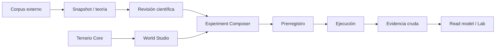

# Mapa del sistema

## Fronteras que no se negocian

- Una fuente no se convierte en verdad por ser importada.
- Una hipótesis no es evidencia.
- Una ejecución sandbox no es evidencia científica.
- La capa visual o de composición no modifica grafos canónicos.

La lista completa y verificable está en [[knowledge/_generated/Estado tecnico#Invariantes científicos|Invariantes científicos]].

## Puntos de entrada

| Necesidad | Punto de entrada |
| --- | --- |
| Ejecutar o verificar el mundo base | `main.py` |
| Servicio local del Lab | `scripts/run_lab.py` |
| Actualizar snapshot teórico | `scripts/build_theory_snapshot.py` |
| Revisión científica determinista | `scripts/build_scientific_review.py` |
| Estado operativo | [[knowledge/_generated/Estado tecnico]] |

Para contratos y límites de escritura, consulta [[knowledge/03 Protocolos/Flujo de trabajo|Flujo de trabajo]] y [LAB_ARCHITECTURE.md](../../docs/LAB_ARCHITECTURE.md).
